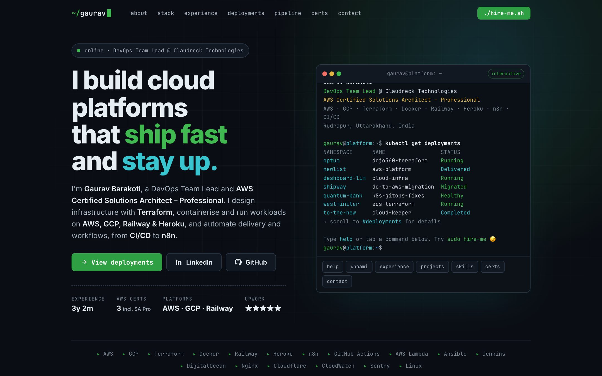
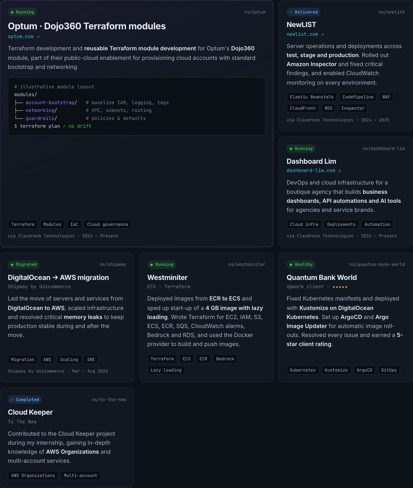
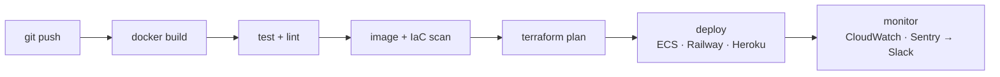
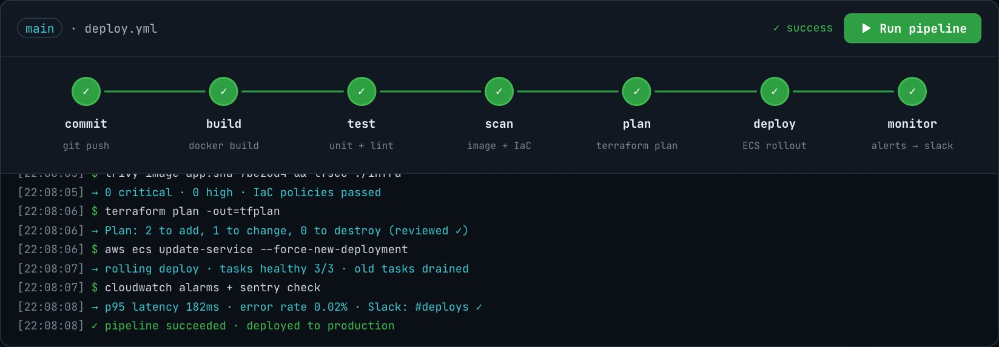
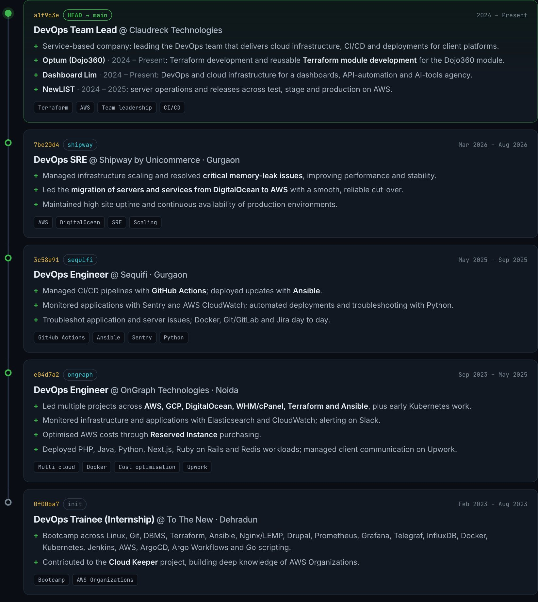
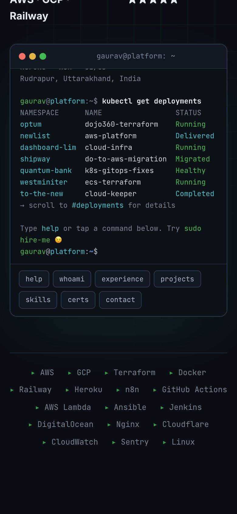

<div align="center">

<a href="https://gauravbarakoti.github.io/platform-engineering-portfolio/">
  
</a>

# Gaurav Barakoti · DevOps & Platform Engineering

**DevOps Team Lead @ Claudreck Technologies** · **AWS Certified Solutions Architect – Professional**<br />
I build cloud platforms that ship fast and stay up.

[](https://gauravbarakoti.github.io/platform-engineering-portfolio/)
[](https://www.linkedin.com/in/gauravbarakoti)
[](mailto:bestgaurav1234@gmail.com)
[](https://github.com/GauravBarakoti/platform-engineering-portfolio/actions/workflows/deploy.yml)


</div>

---

## ⚡ TL;DR

```yaml
name: Gaurav Barakoti
role: DevOps Team Lead @ Claudreck Technologies
certified:
  - AWS Certified Solutions Architect – Professional
  - AWS Certified Solutions Architect – Associate
  - AWS Certified Cloud Practitioner
clouds: [AWS, GCP, Railway, Heroku, DigitalOcean]
iac: [Terraform (incl. reusable modules), Ansible]
containers: [Docker, Amazon ECS/ECR, Elastic Beanstalk]
automation: [GitHub Actions, Jenkins, CodePipeline, n8n, AWS Lambda, Python]
observability: [CloudWatch, Sentry, Elasticsearch, Slack alerting]
strengths: [cloud migrations, cost optimisation, security remediation, client communication, team leadership]
```

---

## 🚀 Selected deployments

| | Project | What I did | Stack |
|---|---|---|---|
| 🟣 | **[Optum](https://www.optum.com) · Dojo360**<br/><sub>2024 – Present</sub> | Terraform development and **reusable Terraform module development** for the Dojo360 module, part of Optum's public-cloud enablement (account bootstrap and networking) | Terraform · IaC modules |
| ✅ | **[NewLIST](http://www.newlist.com)**<br/><sub>2024 – 2025</sub> | Server operations and releases across test, stage and prod. Rolled out **Amazon Inspector** and fixed critical findings, and enabled CloudWatch on every environment | Elastic Beanstalk · CodePipeline · WAF · CloudFront · RDS |
| 🟢 | **[Dashboard Lim](https://dashboard-lim.com)**<br/><sub>2024 – Present</sub> | DevOps and cloud infrastructure for a boutique agency building business dashboards, API automations and AI tools | Cloud infra · Deployments · Automation |
| 🔵 | **DigitalOcean → AWS migration** · Shipway<br/><sub>Mar – Aug 2026</sub> | Led the migration of servers and services, scaled infrastructure and fixed critical **memory leaks** | AWS · DigitalOcean · SRE |
| 🟢 | **Westminiter** | ECR → ECS deploys with **lazy loading for a 4 GB image**. Terraform for EC2, IAM, S3, ECS, ECR, SQS, alarms, Bedrock and RDS, plus the Docker provider for image builds | Terraform · Docker · ECS · Bedrock |
| ⭐ | **Quantum Bank World** (Upwork) | Fixed and deployed manifests on DigitalOcean with GitOps auto-updates. **5-star client rating** | Containers · GitOps |
| ✅ | **Cloud Keeper** · To The New | Contributed during my internship and learned AWS Organizations in depth | AWS Organizations |

<p align="center"></p>

---

## 🧭 Career: `git log --oneline`

```text
* a1f9c3e (HEAD → main) DevOps Team Lead      @ Claudreck Technologies   2024 – Present
* 7be20d4               DevOps SRE            @ Shipway by Unicommerce   Mar 2026 – Aug 2026
* 3c58e91               DevOps Engineer       @ Sequifi                  May 2025 – Sep 2025
* e04d7a2               DevOps Engineer       @ OnGraph Technologies     Sep 2023 – May 2025
* 0f00ba7 (init)        DevOps Trainee        @ To The New               Feb 2023 – Aug 2023
```

<details>
<summary><b>Highlights per role</b></summary>

- **Claudreck Technologies** (service-based, 2024 – Present): leading the DevOps team. Optum Dojo360 Terraform modules (2024 – Present), Dashboard Lim (2024 – Present) and NewLIST (2024 – 2025).
- **Shipway by Unicommerce:** DigitalOcean → AWS migration, scaling, memory-leak fixes and high uptime.
- **Sequifi:** GitHub Actions CI/CD, Ansible deploys, Sentry/CloudWatch monitoring and Python automation.
- **OnGraph:** multi-cloud projects (AWS, GCP, DO, cPanel), Reserved Instance cost savings, Slack alerting and Upwork client management.
- **To The New:** DevOps bootcamp (Terraform, Ansible, Docker, Jenkins, AWS, monitoring) and the Cloud Keeper project.

</details>

---

## 🔁 How I ship



The live site has an **interactive version**: press *Run pipeline* and watch each stage execute.

<p align="center"></p>

---

## 🖥️ The portfolio

<table>
<tr>
<td width="68%"></td>
<td width="32%"></td>
</tr>
</table>

- 💻 **Interactive terminal:** type `help`, `whoami`, `projects`, `skills`, `terraform plan` or `sudo hire-me`
- 🗂️ **Experience as `git log`** and **projects as deployments**, with filters
- ▶️ **Runnable CI/CD pipeline** demo
- 📱 Responsive from 320px phones to 2560px monitors · no frameworks · about 60 fps

<details>
<summary><b>🛠️ Under the hood</b></summary>

```
index.html                     # single page
assets/css/style.css           # terminal theme, responsive layout
assets/js/main.js              # terminal, pipeline demo, filters, nav
assets/img/favicon.svg
.github/workflows/deploy.yml   # GitHub Actions → GitHub Pages on every push to main
.github/readme/                # screenshots for this README
```

Run locally: `python3 -m http.server 8000` → http://localhost:8000

</details>

---

## 🎓 Certifications & education

| Certification | Issuer |
|---|---|
| 🏅 **AWS Certified Solutions Architect – Professional** | Amazon Web Services |
| AWS Certified Solutions Architect – Associate | Amazon Web Services |
| AWS Certified Cloud Practitioner | Amazon Web Services |
| Demystifying Networking (2022) | NPTEL |

**MCA**, Amrapali Group of Institutes, Haldwani (2021–2023) · **B.Sc. Mathematics**, SBS Govt. PG College, Rudrapur (2018–2021)

---

<div align="center">

```bash
$ ssh hello@gaurav-barakoti
```

[](mailto:bestgaurav1234@gmail.com)
[](https://www.linkedin.com/in/gauravbarakoti)

</div>
